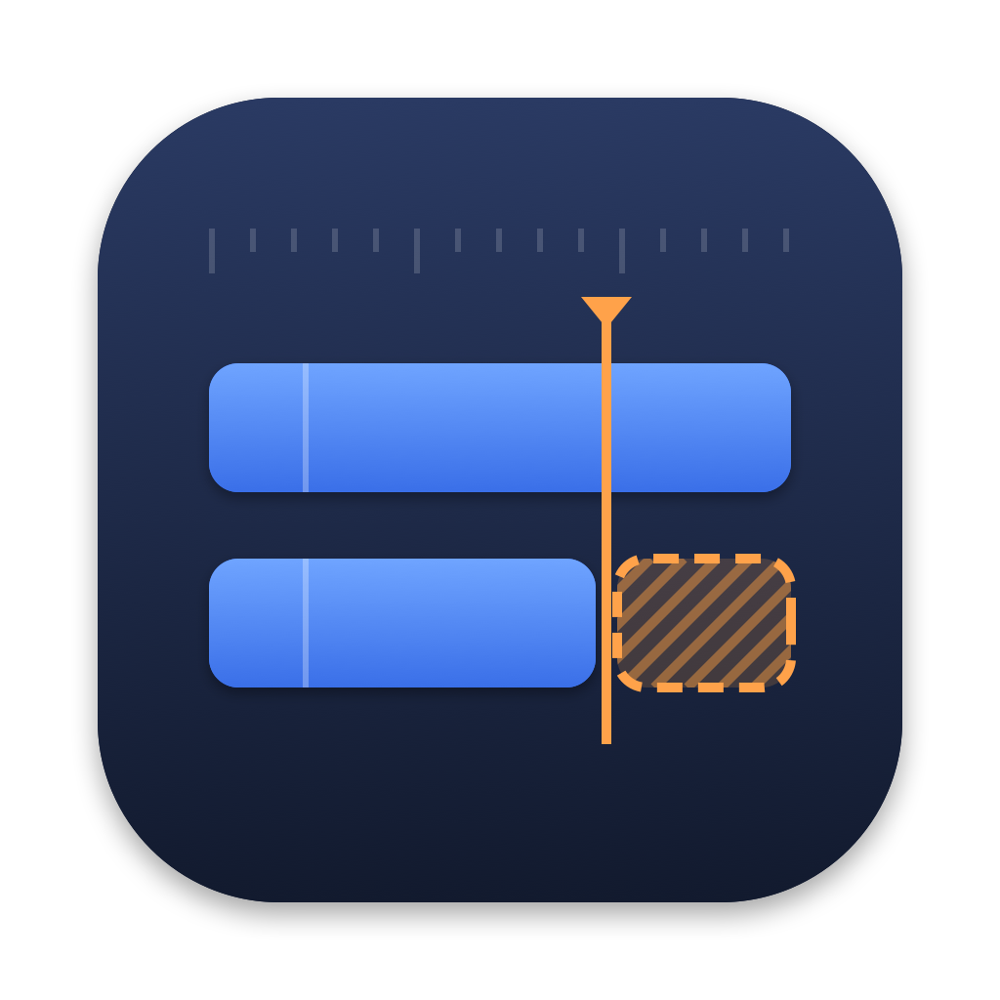

# Bin Diff

Compare two Avid bins and see every difference. Clips are linked by their **Tape** name; every other column the two bins share is compared — Name, Duration, Start, End, Tracks, FPS, and user columns such as Scene, Take and Comments. Duration differences are also ranked biggest first. The result is an HTML report plus a CSV.



## For editors: the Mac app

1. Download **Bin-Diff.zip** from the [latest release](https://github.com/absolute-cinema-jpg/bin-diff/releases/latest) and unzip it.
2. Drag **Bin Diff** into your Applications folder.
3. First launch only: double-click it, click **Done** on the warning, then go to **System Settings → Privacy & Security** and click **Open Anyway**. (On macOS 13/14 you can right-click the app → **Open** instead.)
4. Choose or drag in **Bin A** and **Bin B**, then click **Compare**. The report opens in your browser and is saved to `Documents/Bin Diff Reports` (changeable in Settings).

The app checks for updates once a day and can install them itself. **Report a Bug…** opens a pre-filled GitHub issue. Settings are kept when you quit or update.

Runs on Intel and Apple Silicon Macs, macOS 11 or later. Python and everything else it needs are inside the app.

### Settings

- **Columns** — which columns are compared. Columns from bins you compare are added automatically; untick any you don't care about (Modified Date is off by default). Optionally ignore upper/lower case differences in values.
- **Report** — which sections appear (summary, differences by column, ranked durations, metadata differences, columns not compared, only in A/B, no tape name, identical clips) and the duration table's columns.
- **General** — where reports are saved, open automatically, CSV on/off, ignore duration differences of up to N frames, case-sensitive tape names, include subclips.

## Inputs

- `.avb` Avid bins, read directly (via a bundled copy of [pyavb](https://github.com/markreidvfx/pyavb), MIT licence). Columns read: Name, Duration, Start, End, Tracks, FPS, Resolution, Creation Date, Modified Date, plus the clip's user columns.
- `.ale` exports
- Tab-delimited bin exports (`.txt`/`.tab`/`.tsv`/`.csv`) — every exported column is compared.

Master clips are compared; a bin with only subclips (e.g. AutoSync bins) uses its subclips. Hidden reference clips inside a bin are ignored. Columns that exist in only one of the two bins are listed in the report rather than compared.

## Command line

```bash
python3 bin_diff.py "Picture.avb" "Sync.avb" --open
python3 bin_diff.py A.avb B.avb --ignore-columns "Modified Date,Comments" --tolerance 2
python3 bin_diff.py --help
```

No installs needed — pyavb is in `vendor/`.

## Building and releasing

Needs the Xcode Command Line Tools (`xcode-select --install`).

```bash
./build_app.sh                      # -> dist/Bin Diff.app and dist/Bin-Diff.zip
./release.sh 2.0.1 "What changed"   # builds that version and publishes a GitHub release
```

The in-app updater installs the newest GitHub release whose tag (`vX.Y.Z`) is higher than the running version, so bump the version for every release. Don't change the bundle ID in `build_app.sh` — settings and updates depend on it.

| Path | What it is |
| --- | --- |
| `bin_diff.py` | The comparison engine and report writer |
| `mac/` | SwiftUI app (window, settings, updater, bug report), the icon, and the "How to open" note |
| `vendor/avb` | pyavb 1.4.0 (MIT) |
| `build_app.sh` / `release.sh` | Build the app / publish a release |

## Licence

Copyright © 2026 Alex Stuart.

Bin Diff is free software: you can redistribute it and/or modify it under the terms of the [GNU General Public License v3](LICENSE) as published by the Free Software Foundation. It is distributed in the hope that it will be useful, but WITHOUT ANY WARRANTY; without even the implied warranty of MERCHANTABILITY or FITNESS FOR A PARTICULAR PURPOSE. The bundled pyavb library is MIT-licensed (`vendor/avb/LICENSE-pyavb.txt`).

---
by Alex Stuart
